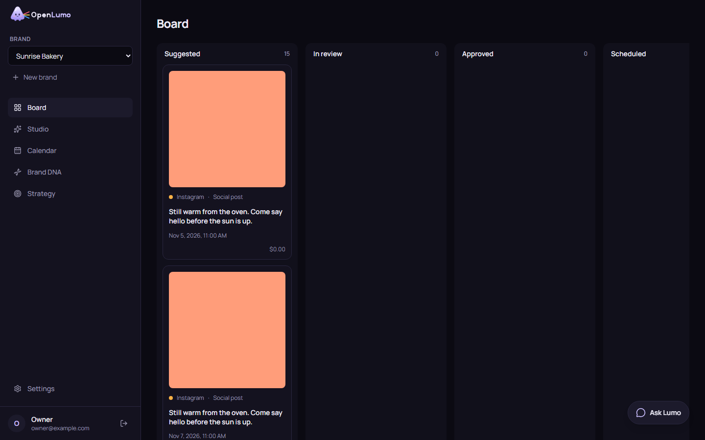

# OpenLumo

OpenLumo is an open-source, self-hosted AI marketing studio. Paste your website, and Lumo learns your brand, plans a month of content, drafts posts, ads, emails and blog articles with matching images, and puts everything on a board where you approve, edit or regenerate each piece.

Lumo does the work, you keep the veto: nothing leaves the board without an explicit yes.



## Quick start

You need Docker with Compose and an [OpenRouter](https://openrouter.ai) API key.

```sh
cp .env.example .env
```

Open `.env` and set `APP_SECRET` to a random string of at least 32 characters, for example the output of `openssl rand -base64 48`. Then start everything:

```sh
docker compose up
```

This starts Postgres, runs the database migrations once, and starts the web app and the worker. Open http://localhost:3000 and create an account. The first account on an instance becomes its admin.

If you serve OpenLumo from another address, set `PUBLIC_URL` in `.env` to that address.

## Configuring OpenRouter

OpenLumo talks to models through OpenRouter, with your own key. After signing up, the admin goes through a short setup wizard:

1. Paste your OpenRouter API key. OpenLumo checks it before saving it, stores it encrypted and never sends it to the browser.
2. Choose the brain model, which writes the brand DNA, strategy, copy and chat replies.
3. Choose the image model, which draws the images for posts and ads.

You can change the key and both models at any time under Settings. A new model applies to the next job without a restart.

## Development

Requirements: Node.js 22 or newer and pnpm through Corepack (`corepack enable`).

```sh
pnpm install
cp .env.example .env
docker compose up -d postgres
pnpm db:migrate
pnpm dev
```

`pnpm dev` runs the web app on http://localhost:3000 and the worker side by side.

| Command | What it does |
|---|---|
| `pnpm dev` | Web app and worker in watch mode |
| `pnpm lint` | ESLint over the whole repository |
| `pnpm typecheck` | TypeScript in every package |
| `pnpm test` | Unit tests |
| `pnpm test:integration` | Tests against a real Postgres (reads `TEST_DATABASE_URL`) |
| `pnpm e2e` | Playwright end-to-end tests with fake models |
| `pnpm db:generate` | Generate a migration after changing the Drizzle schema |
| `pnpm db:migrate` | Apply pending migrations |

The end-to-end tests need Postgres and Chromium (`pnpm --filter @openlumo/web exec playwright install chromium`). They create a fresh `openlumo_e2e` database, serve a small fixture website on port 4100, build the web app and run it on port 3200 together with the worker. Models are replaced by deterministic fakes, so no API key or network access to model providers is needed.

## Architecture

```
apps/
  web/        Next.js app: pages, server actions, API routes
  worker/     Node process that runs background jobs
packages/
  core/       Domain logic: crawling, brand DNA, planning, studio, export, chat
  db/         Drizzle schema and migrations for Postgres
  providers/  Capability-typed model adapters, starting with OpenRouter
```

- **Jobs.** The web app never calls a model. Every generation is a pg-boss job in Postgres: crawling a site, writing the brand DNA, creating a strategy, planning a month, drafting an item, regenerating it, building an export, replying in chat. The worker runs them with retries and records each run with its progress and cost.
- **Live progress.** The worker publishes job events with `pg_notify`. The web app listens on Postgres and streams the events to the browser over server-sent events, so cards and progress labels update without polling.
- **Providers.** Models are typed by capability (`LanguageModel`, `ImageModel`), and domain code depends only on those interfaces. OpenRouter is the first adapter; settings map each capability to a model.
- **Storage.** Images and exports are stored on local disk under `STORAGE_DIRECTORY`. In Docker that is the `assets` volume shared by the web app and the worker.

## Limitations

- Registration is open: anyone who can reach the instance can create an account. Protect it at the network level, for example behind a VPN, a private network or an authenticating reverse proxy.
- Export ZIPs are built in memory, with at most 200 items per export.
- Version 0.1 does not publish to social networks or email platforms, and has no analytics, autopilot, video or audio.
- If the worker crashes in the middle of a chat reply, an action Lumo takes from the chat (such as drafting a new item) may run again when the reply is retried.
- The crawler reads at most 10 pages of a website.

## Roadmap

1. Publishing: OAuth connections and native posting for LinkedIn, X, Instagram, Facebook and email providers.
2. Analytics and learning loop: import performance data, report what worked, feed results back into planning.
3. Autopilot: per-channel automatic approval with guardrails.
4. Video and audio: short video ads, voiceover and music through OpenRouter video and speech models.
5. Local providers: Ollama and LM Studio for the brain, ComfyUI for images and video, local TTS for audio.
6. Localisation and competitor tracking.

## License

The code is released under the [MIT License](LICENSE). The OpenLumo name, the Lumo character and the logo are covered by the [trademark policy](TRADEMARKS.md).
