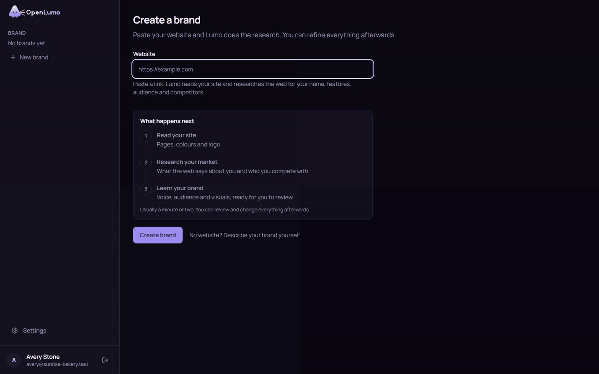
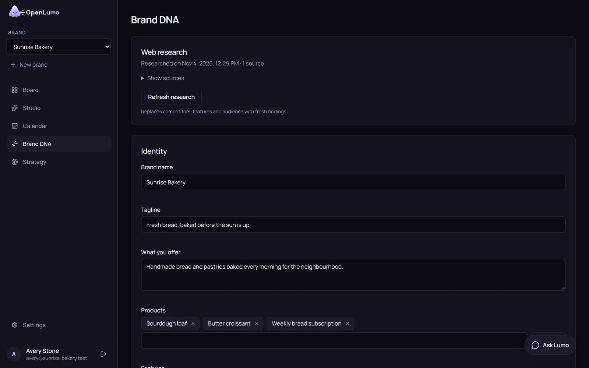
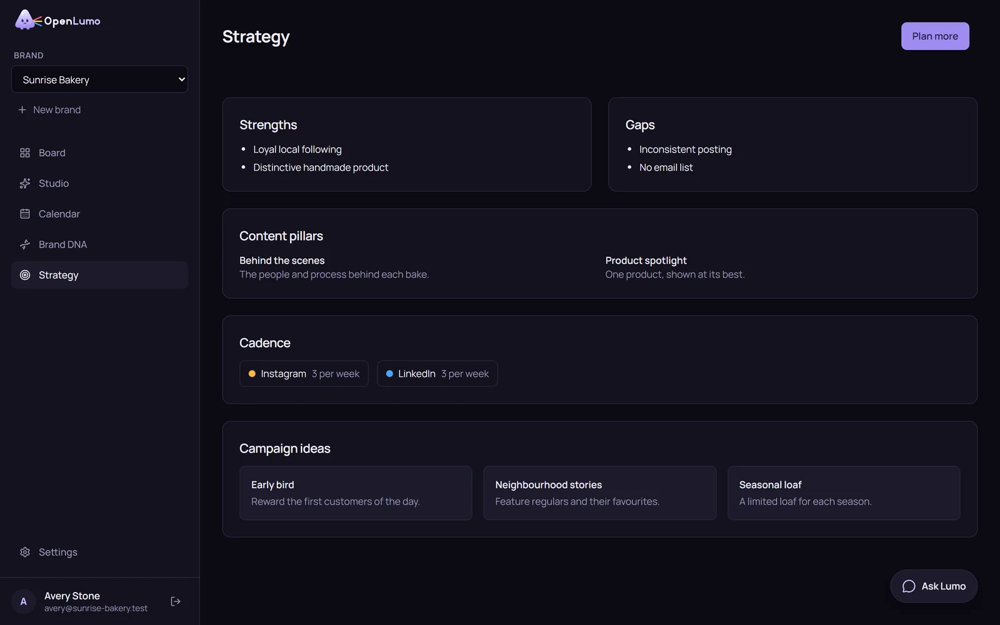
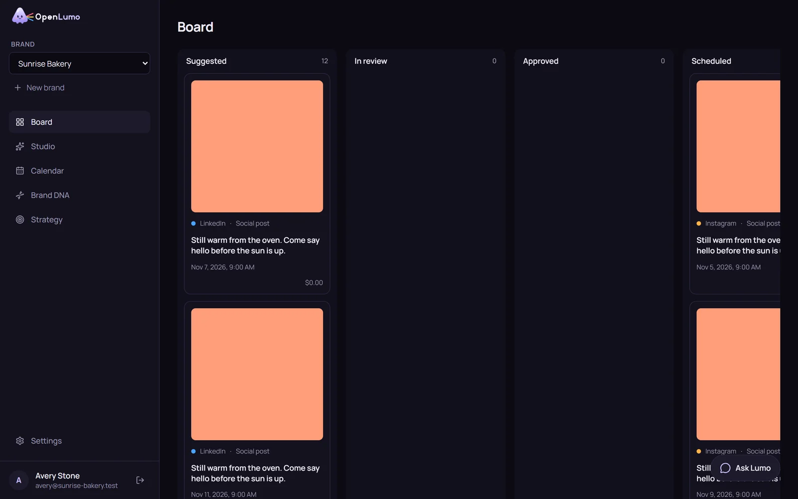
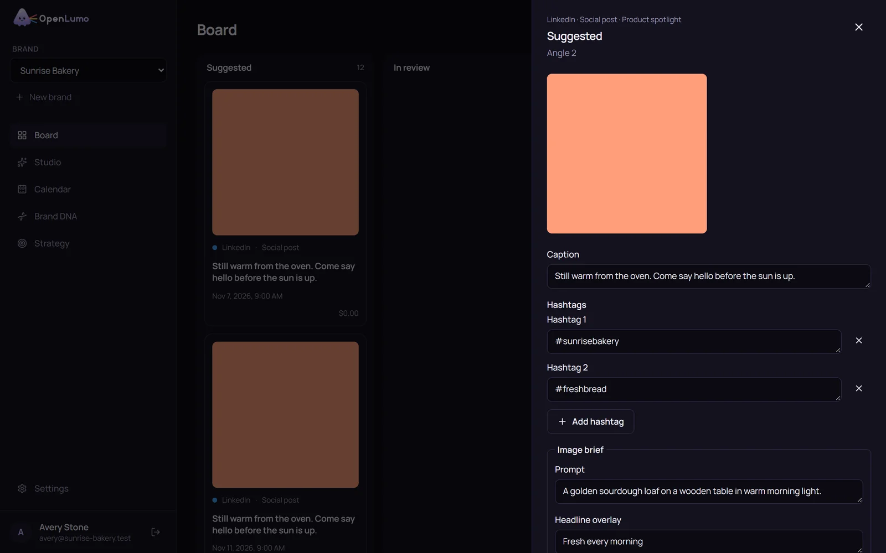
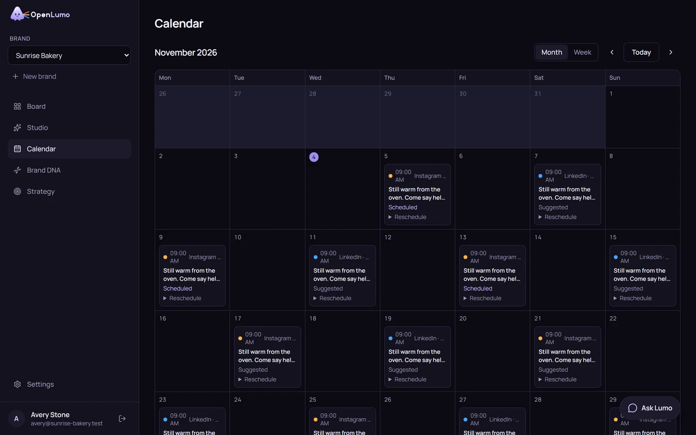
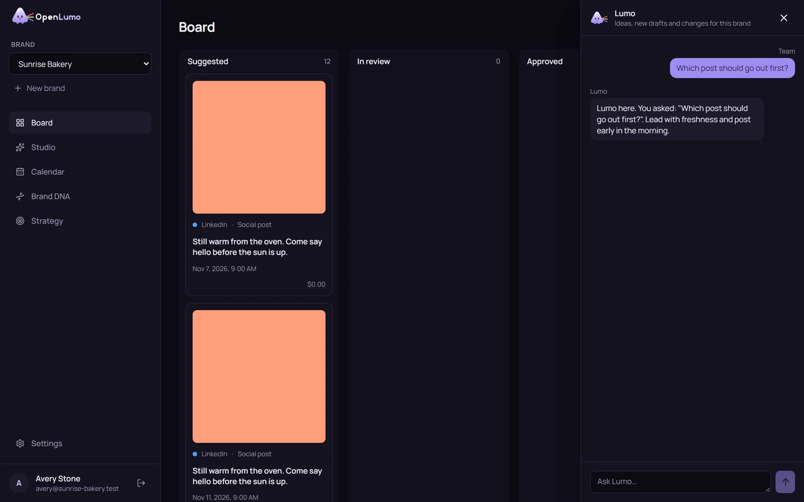
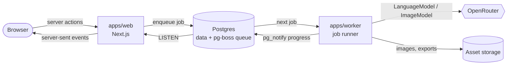

<p align="center">
  <a href="https://kotlovyim-dev.github.io/OpenLumo/">
    
  </a>
</p>

<h3 align="center">The open-source, self-hosted AI marketing studio</h3>

<p align="center">
  Paste a link to your website. Lumo learns your brand, plans a month of content<br>
  and drafts every post, ad, email and article. You approve each one.
</p>

<p align="center">
  <a href="LICENSE"></a>
  <a href="#quick-start"></a>
  <a href="https://openrouter.ai"></a>
  
  
</p>

<p align="center">
  <a href="https://kotlovyim-dev.github.io/OpenLumo/"><strong>Website</strong></a> ·
  <a href="#quick-start"><strong>Quick start</strong></a> ·
  <a href="#features">Features</a> ·
  <a href="#architecture">Architecture</a> ·
  <a href="#roadmap">Roadmap</a>
</p>

<p align="center">
  
</p>

## What is OpenLumo?

OpenLumo is an open-source, self-hosted AI marketing studio. Paste a link to your website, and Lumo reads your site, researches your brand, audience and competitors on the live web, plans a month of content, drafts posts, ads, emails and blog articles with matching images, and puts everything on a board where you approve, edit or regenerate each piece.

Lumo does the work, you keep the veto: nothing leaves the board without an explicit yes.

- **Your instance, your data.** One `docker compose up` runs the whole studio on your own machine or server.
- **Your models, your bill.** Bring an OpenRouter key and pick any brain and image model. There is no subscription and no markup, and each job shows what it cost.
- **Work you can watch.** Every step streams live: Lumo reading pages, writing the strategy, drafting each card.

## See it in action

<p align="center">
  
</p>

<p align="center"><sub>From a link to a scheduled post: create a brand, watch the research and the strategy come in, approve a draft. Recorded on a demo instance with the built-in test models, so the images are flat placeholders and the drafts share one caption. The drafting step is sped up.</sub></p>

## How it works

| | Step | What happens |
|---|---|---|
| 1 | **Paste a link** | Lumo reads up to 10 pages of your site and picks up your colours, logo and copy. |
| 2 | **Lumo does the research** | The brain model searches the live web for your features, audience and competitors, and keeps a source link for every finding. |
| 3 | **Review the Brand DNA** | Identity, audience, voice and visuals land in one editable profile that every later job reads. |
| 4 | **Get a strategy** | Choose a goal and your channels. Lumo finds your strengths and gaps, then sets pillars, cadence and campaign ideas. |
| 5 | **Approve the drafts** | A month of posts arrives on the board with copy and images. Approve, edit, regenerate or export each one. |

## Features

<table>
  <tr>
    <td width="50%" valign="top">
      
      <h4>Brand DNA from a single link</h4>
      Identity, products, audience, voice and visuals, researched on the live web with sources. Edit anything, and refresh the research when your market moves.
    </td>
    <td width="50%" valign="top">
      
      <h4>A strategy you can read</h4>
      Strengths, gaps, content pillars, posting cadence per channel and campaign ideas. Lumo shows each step live as it writes the plan.
    </td>
  </tr>
  <tr>
    <td width="50%" valign="top">
      
      <h4>An approval board</h4>
      Every draft is a card that moves from Suggested to In review, Approved and Scheduled. Cards update live as the worker drafts them, and each one shows its cost.
    </td>
    <td width="50%" valign="top">
      
      <h4>Edit every draft</h4>
      Change the caption, hashtags, image prompt and headline overlay. Regenerate the copy, the image or both, with notes for Lumo, then export the copy and images as a ZIP.
    </td>
  </tr>
  <tr>
    <td width="50%" valign="top">
      
      <h4>A content calendar</h4>
      Month and week views of everything planned, colour-coded by channel. Move a post to another day without leaving the calendar.
    </td>
    <td width="50%" valign="top">
      
      <h4>Ask Lumo</h4>
      A chat panel on every brand page. Ask for ideas or opinions, or ask Lumo to draft something new straight onto the board.
    </td>
  </tr>
</table>

### Channels and formats

| Channel | Formats |
|---|---|
| Instagram, Facebook, LinkedIn | Social post, carousel, static ad |
| X, TikTok | Social post, static ad |
| Email | Email |
| Blog | Blog article |

Outside the monthly plan, the **Studio** makes any of these on demand, up to four variants at a time from a short brief.

## Quick start

You need Docker with Compose and an [OpenRouter](https://openrouter.ai) API key.

```sh
git clone https://github.com/kotlovyim-dev/OpenLumo.git
cd OpenLumo
cp .env.example .env
```

Open `.env` and set `APP_SECRET` to a random string of at least 32 characters, for example the output of `openssl rand -base64 48`. Then start everything:

```sh
docker compose up
```

This starts Postgres, runs the database migrations once, and starts the web app and the worker. Open http://localhost:3000 and create an account. The first account on an instance becomes its admin.

If you serve OpenLumo from another address, set `PUBLIC_URL` in `.env` to that address.

<details>
<summary><strong>Configuring OpenRouter</strong></summary>
<br>

OpenLumo talks to models through OpenRouter, with your own key. After signing up, the admin goes through a short setup wizard:

1. Paste your OpenRouter API key. OpenLumo checks it before saving it, stores it encrypted and never sends it to the browser.
2. Choose the brain model, which writes the brand DNA, strategy, copy and chat replies.
3. Choose the image model, which draws the images for posts and ads.

You can change the key and both models at any time under Settings. A new model applies to the next job without a restart.

OpenRouter asks for a minimum credit balance before it serves image models. If a draft's image fails, its card shows the error code and a Retry button.

</details>

<details>
<summary><strong>Web research</strong></summary>
<br>

When you create a brand from a link, Lumo reads up to 10 pages of the site and then asks the brain model to research the brand on the live web through the OpenRouter web search plugin. The research fills in the brand name, product features, audience and where it spends time, and three to five competitors with their positioning, strengths and weaknesses. Every finding keeps its source link, and competitor websites are checked before they are saved.

Markets move quickly, so the Brand DNA page shows when the research ran and lets owners and editors refresh it. A refresh replaces competitors, features and audience and leaves the rest of the Brand DNA as it is.

Web search uses the same OpenRouter key and is billed by OpenRouter per search result on top of the model tokens. The cost shows up on each research run like any other job. If the search fails, Lumo still learns the brand from the site alone and the Brand DNA page offers to try again.

</details>

<details>
<summary><strong>Environment variables</strong></summary>
<br>

| Variable | Purpose |
|---|---|
| `APP_SECRET` | Signs sessions and encrypts the stored API key. At least 32 characters. |
| `DATABASE_URL` | Postgres connection string. Docker Compose sets it for you. |
| `PUBLIC_URL` | The address people use to open OpenLumo. |
| `STORAGE_DIRECTORY` | Where images and exports are written. |
| `GLOBAL_JOB_CONCURRENCY` | How many jobs the worker runs at once. |
| `BRAND_JOB_CONCURRENCY` | How many jobs run at once for a single brand. |
| `CRAWLER_ALLOW_PRIVATE_HOSTS` | Let the crawler read private network addresses. Leave it `false` in production. |

</details>

## Development

Requirements: Node.js 22 or newer and pnpm through Corepack (`corepack enable`).

```sh
pnpm install
cp .env.example .env
docker compose up -d postgres
pnpm db:migrate
pnpm dev
```

`pnpm dev` runs the web app on http://localhost:3000 and the worker side by side.

| Command | What it does |
|---|---|
| `pnpm dev` | Web app and worker in watch mode |
| `pnpm lint` | ESLint over the whole repository |
| `pnpm typecheck` | TypeScript in every package |
| `pnpm test` | Unit tests |
| `pnpm test:integration` | Tests against a real Postgres (reads `TEST_DATABASE_URL`) |
| `pnpm e2e` | Playwright end-to-end tests with fake models |
| `pnpm db:generate` | Generate a migration after changing the Drizzle schema |
| `pnpm db:migrate` | Apply pending migrations |

The end-to-end tests need Postgres and Chromium (`pnpm --filter @openlumo/web exec playwright install chromium`). They create a fresh `openlumo_e2e` database, serve a small fixture website on port 4100, build the web app and run it on port 3200 together with the worker. Models are replaced by deterministic fakes, so no API key or network access to model providers is needed.

## Architecture



```
apps/
  web/        Next.js app: pages, server actions, API routes
  worker/     Node process that runs background jobs
packages/
  core/       Domain logic: crawling, web research, brand DNA, planning, studio, export, chat
  db/         Drizzle schema and migrations for Postgres
  providers/  Capability-typed model adapters, starting with OpenRouter
```

- **Jobs.** The web app never calls a model. Every generation is a pg-boss job in Postgres: crawling a site, researching the brand on the web, writing the brand DNA, creating a strategy, planning a month, drafting an item, regenerating it, building an export, replying in chat. The worker runs them with retries and records each run with its progress and cost.
- **Live progress.** The worker publishes job events with `pg_notify`. The web app listens on Postgres and streams the events to the browser over server-sent events, so cards and progress labels update without polling.
- **Providers.** Models are typed by capability (`LanguageModel`, `ImageModel`), and domain code depends only on those interfaces. OpenRouter is the first adapter; settings map each capability to a model.
- **Storage.** Images and exports are stored on local disk under `STORAGE_DIRECTORY`. In Docker that is the `assets` volume shared by the web app and the worker.

**Stack:** TypeScript, Next.js, React, Tailwind CSS, Postgres, Drizzle ORM, pg-boss, Better Auth, Vitest, Playwright, Turborepo, pnpm.

## Limitations

- Registration is open: anyone who can reach the instance can create an account. Protect it at the network level, for example behind a VPN, a private network or an authenticating reverse proxy.
- Export ZIPs are built in memory, with at most 200 items per export.
- Version 0.1 does not publish to social networks or email platforms, and has no analytics, autopilot, video or audio.
- If the worker crashes in the middle of a chat reply, an action Lumo takes from the chat (such as drafting a new item) may run again when the reply is retried.
- The crawler reads at most 10 pages of a website.

## Roadmap

- [x] **v0.1, the core loop:** brand from a link, web research, Brand DNA, strategy, monthly plan, drafts with images, approval board, calendar, studio, chat and ZIP export
- [ ] **Publishing:** OAuth connections and native posting for LinkedIn, X, Instagram, Facebook and email providers
- [ ] **Analytics and learning loop:** import performance data, report what worked, feed results back into planning
- [ ] **Autopilot:** per-channel automatic approval with guardrails
- [ ] **Video and audio:** short video ads, voiceover and music through OpenRouter video and speech models
- [ ] **Local providers:** Ollama and LM Studio for the brain, ComfyUI for images and video, local TTS for audio
- [ ] **Localisation** and competitor tracking over time

## Contributing

Issues and pull requests are welcome. For anything larger than a small fix, open an issue first so we can agree on the approach. Before you send a pull request, run `pnpm lint`, `pnpm typecheck` and `pnpm test`, and `pnpm e2e` if you changed a user flow.

## License

The code is released under the [MIT License](LICENSE). The OpenLumo name, the Lumo character and the logo are covered by the [trademark policy](TRADEMARKS.md).
